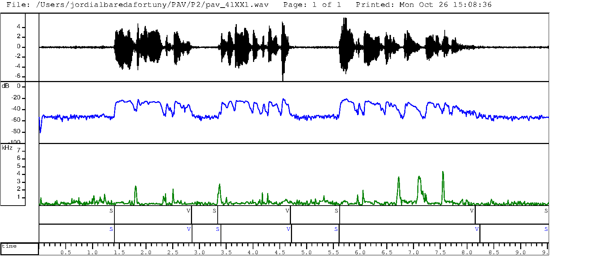
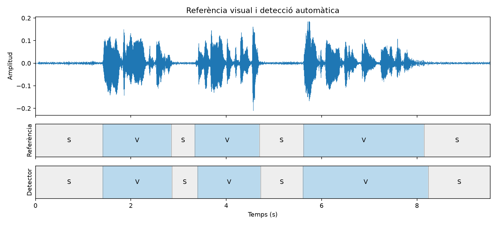

# P2 — Detecció d'activitat vocal

Jordi Albareda Fortuny · Grup 41 · Lloc XX

Les idees, les proves separades i la comparació de totes les combinacions estan explicades amb paraules senzilles a [IDEES.md](IDEES.md). El programa de l’estudi és a la branca `jordi-albareda-combinacions`. Mantinc aquesta versió d’entrega: el millor resultat nou només la supera en uns 0,002 punts.

## Configuració final

La branca d’entrega és `jordi-albareda`. Incorpora el marge configurable, els scripts d’escombratge i la configuració actual d’entrega, verificada amb l’avaluador original.

| Paràmetre | Valor per defecte |
|---|---:|
| Inicialització | 90 ms |
| Veu mínima | 80 ms |
| Silenci mínim | 170 ms |
| Marge sobre el soroll | 5,94 dB |
| Coeficient d’actualització del soroll | 0,00615 |

**TOTAL sobre les 115 gravacions de `db.v4`: 95,829 %.** Aquest resultat s’obté sense opcions addicionals, tal com s’executarà el programa en l’avaluació cega. Supera la base de 95,474 % en 0,355 punts i l’ajust anterior de marge de 95,653 % en 0,176 punts. No és una mesura de generalització: tots aquests paràmetres s’han ajustat sobre la base de desenvolupament.


## Ajust reproduïble

```sh
python3 scripts/optimitza_parametres.py
```

Necessita un compilador C, NumPy i SoundFile. Calcula les potències amb `compute_power()` i executa el mateix autòmat de `src/vad.c` en una biblioteca temporal. Les etiquetes de referència només s’utilitzen per puntuar les decisions; el detector continua processant un sol bloc cada vegada.

La cerca conjunta prova 13.440 combinacions d’inicialització, duracions mínimes, marge i actualització del soroll. Després afina els cinc paràmetres per coordenades durant tres passades: **14.152 configuracions diferents** en total. Conservo totes les puntuacions a [optimitzacio_final.csv](resultats/optimitzacio_final.csv), ordenades de millor a pitjor. La cerca és finita; el millor resultat provat no garanteix un òptim global ni el mateix resultat sobre dades desconegudes.

La configuració seleccionada s’ha recompilat i avaluat sobre els WAVE originals amb `vad_evaluation.pl`, sense usar la biblioteca temporal. [Avaluació final completa](resultats/evaluacio_final.txt).

Per explorar només el marge:

```sh
./cardem-li 4 0.1 10
./cardem-li 5.8 0.01 6.1
scripts/run_vad.sh             # Configuració final per defecte
scripts/run_vad.sh 6.63        # Mateix autòmat final amb un altre marge
```

Els arguments de `cardem-li` són inici, pas i final. Els resultats antics `cardem-li_4_0.1_10` i `cardem-li_6.5_0.01_6.7` corresponen a la configuració anterior de 100/80/150 ms i alfa 0,02: no s’han de confondre amb la configuració final.

## Compilació i execució

Necessito Meson, Ninja i `libsndfile`.

```sh
meson setup bin
ninja -C bin
bin/vad -i pav_41XX1.wav -o pav_41XX1.vad
```

`meson bin` és la forma antiga de `meson setup bin`. Amb `-v` mostro temps, estat intern, potència i llindar. Les etiquetes del fitxer de sortida són només `S` i `V`.

## Etiquetatge de veu i silenci

Reutilitzo la gravació de P1: 9,536 s, mono, PCM de 16 bits i 16 kHz. El nom és `pav_41XX1.wav`: grup 41, lloc XX i gravació 1.

Fixo els límits per inspecció visual de la forma d'ona i la potència, abans de comparar-los amb el detector. Són aproximats; no marco les pauses curtes dins d'una frase.

| Inici (s) | Final (s) | Etiqueta |
|---:|---:|:---:|
| 0,000 | 1,410 | S |
| 1,410 | 2,850 | V |
| 2,850 | 3,340 | S |
| 3,340 | 4,700 | V |
| 4,700 | 5,620 | S |
| 5,620 | 8,150 | V |
| 8,150 | 9,536 | S |

Cada fila de [pav_41XX1.lab](pav_41XX1.lab) conté inici, final i etiqueta.



De dalt a baix: forma d'ona, potència, ZCR, referència visual en negre i detecció automàtica en blau.

### Llindar de potència

El silenci inicial complet té una potència mitjana de **−52,40 dB**. Els primers 90 ms, que faig servir per inicialitzar el detector, donen **−54,27 dB**.

Trio un marge de **5,94 dB** sobre el soroll: el llindar inicial és aproximadament **−48,33 dB**. Durant el silenci actualitzo la referència amb `soroll += 0.00615 * (potència - soroll)`.

### Duracions mínimes

- Veu: **80 ms** per descartar pics curts.
- Silenci: **170 ms** per no tallar pauses breus dins de les paraules.

Les dues pauses internes de la referència duren 490 i 920 ms.

### Creuaments per zero

El ZCR mitjà del silenci inicial és **346 Hz** i el màxim de la gravació és **4377 Hz**. Augmenta en alguns sons de poca amplitud, però no separa sempre veu i silenci. El represento per analitzar-lo; el detector decideix amb potència i duració.

## Detector

Reutilitzo `compute_power()` de P1. Processo blocs de 10 ms amb cinc estats:

1. **INIT:** estimo el soroll amb la mitjana de potències lineals dels primers 90 ms.
2. **SILENCE:** espero que la potència superi el llindar.
3. **MAYBE_VOICE:** confirmo la veu després de 80 ms seguits per sobre del llindar.
4. **VOICE:** espero una baixada de potència.
5. **MAYBE_SILENCE:** confirmo el silenci després de 170 ms seguits per sota del llindar.

Si una candidatura és massa curta, mantinc l'estat anterior. Quan confirmo un canvi, situo el límit al primer bloc provisional. Al final del fitxer resolc els blocs pendents amb l'última decisió confirmada i incloc les mostres del darrer bloc incomplet.

Només guardo les mostres d'un bloc i els comptadors de l'autòmat. No llegeixo blocs futurs ni les etiquetes de referència per detectar la veu.

### Comparació amb la referència



| Segment de veu | Referència (s) | Detector (s) |
|---|---|---|
| 1 | 1,410–2,850 | 1,410–2,860 |
| 2 | 3,340–4,700 | 3,400–4,690 |
| 3 | 5,620–8,150 | 5,610–8,240 |

El detector perd 60 ms a l'inici poc potent del segon fragment. Allarga 90 ms el final del tercer, on la veu es confon amb el soroll. La resta de diferències són de 10 ms.

En aquesta gravació obtinc **98,69 % de sensibilitat de veu**, **97,95 % de precisió de veu** i **98,335 % de puntuació**. Resultat complet: [evaluacio_personal.txt](resultats/evaluacio_personal.txt).

```sh
perl scripts/vad_evaluation.pl pav_41XX1.lab
```

## Avaluació de `db.v4`

| Versió | Inicialització | Veu mínima | Silenci mínim | Marge | Alfa | TOTAL |
|---|---:|---:|---:|---:|---:|---:|
| Base anterior | 100 ms | 80 ms | 150 ms | 6 dB | 0,02 | 95,474 % |
| Ajust anterior del marge | 100 ms | 80 ms | 150 ms | 6,63 dB | 0,02 | 95,653 % |
| **Final** | **90 ms** | **80 ms** | **170 ms** | **5,94 dB** | **0,00615** | **95,829 %** |

| Estat | Sensibilitat (*recall*) | Precisió |
|---|---:|---:|
| Veu | **98,08 %** | **92,54 %** |
| Silenci | **87,67 %** | **96,70 %** |

El resultat és la mitjana geomètrica `sqrt(F2(veu) * F0.5(silenci))`, no una F1 simple. Respecte de l’ajust anterior de 6,63 dB, augmenta la sensibilitat de veu i baixa la precisió de veu; millora el criteri TOTAL que demana l’enunciat.

`scripts/run_vad.sh` analitza les 115 gravacions, copia les referències sense modificar-les i desa les prediccions a `resultats/db/llindar_5.94`. L’avaluador afegeix silenci al final de tres referències més curtes que l’àudio. [Resultat complet](resultats/evaluacio_final.txt).

No faig servir la gravació personal per ajustar els paràmetres. El detector pot fallar si la veu comença durant la inicialització o si el soroll canvia bruscament.

## Comprovacions

- Compilació sense avisos i recompilació de les dependències amb Ninja.
- Sortides amb només `S` i `V`, contínues i amb la durada real dels 115 àudios.
- Clics curts, pauses dins de la veu, decisions pendents al final i blocs incomplets.
- Àudios curts, silenci absolut, 8/16/48 kHz i errors d'entrada o sortida.

[Comprovació de la versió final](resultats/comprovacio_final.txt): compilació neta, 115 sortides idèntiques al binari avaluat i casos sintètics a 8, 16 i 48 kHz. Els registres anteriors es conserven com a historial.

[Registre de proves anterior](resultats/proves.txt).

[Comprovacions de `-l`, `run_vad.sh` i `cardem-li`](resultats/proves_bash.txt).

[Comprovacions dels escombratges decimals i del rànquing](resultats/proves_escombratge.txt).

## Extres

Incorporo el marge configurable amb `-l` mitjançant el `docopt_c` del codi base. Les duracions continuen definides al codi. La cancel·lació del silenci no està implementada.

Sortida real de l’ajuda i exemple amb el marge explícit:


## Figures

Per regenerar les figures en aquest Mac, amb l'entorn Python de P1:

```sh
../P1/.venv/bin/python scripts/grafiques.py
../P1/.venv/bin/python scripts/grafiques_final.py
../P1/.venv/bin/python scripts/visualitza_wavesurfer.py --export
```

Sense `--export`, el segon script obre els panells interactius de WaveSurfer. Els scripts de figures necessiten NumPy, Matplotlib i SoundFile.

## Entrega

Branca d’entrega: `jordi-albareda`. Les branques de proves es conserven separades. El repositori remot configurat és `victor836768/P2`.

Per completar l’entrega, cal fer el pull request indicat al repositori de la pràctica i pujar `pav_41XX1.wav` i `pav_41XX1.lab` a Atenea.

## Referències

- [Enunciat de P2](p2_vad.pdf).
- Codi inicial i avaluador proporcionats al repositori de la pràctica.
- Funcions d'anàlisi i gravació reutilitzades de P1.
