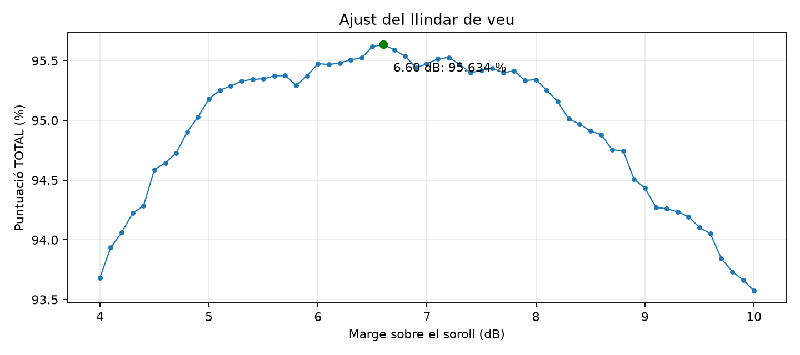
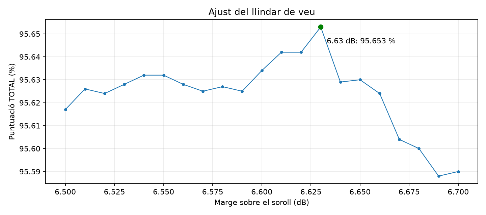
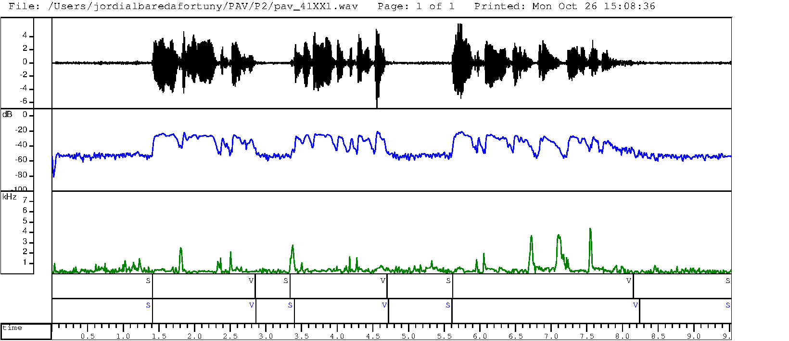
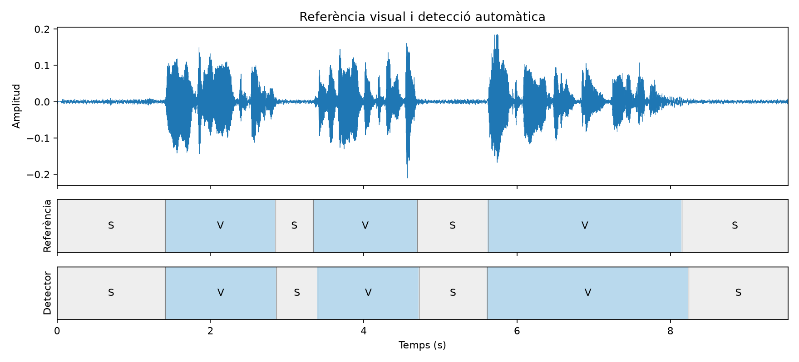

# P2 — Detecció d'activitat vocal

Jordi Albareda Fortuny · Grup 41 · Lloc XX

## Script de proves de classe

Branca `jordi-albareda-canvis-classe-bash-script`, creada a partir de `jordi-albareda`. Faig servir el detector base amb un sol llindar.

```sh
ninja -C bin
./cardem-li                    # De 4 a 10 dB, amb pas de 0.1
./cardem-li 4 0.01 10          # De 4 a 10 dB, amb pas de 0.01: 601 proves
./cardem-li 6.5 0.01 6.7       # Afinament: 21 proves
```

Els arguments són **inici, pas i final**, com a `seq`. Faig servir el punt decimal. No he de recompilar entre proves.

El bucle crida `scripts/run_vad.sh`, mostra el marge i el `TOTAL`, i desa:

- `.txt`: resultats en ordre de prova.
- `_ordenat.txt`: resultats ordenats de millor a pitjor amb `sort -t: -k2,2nr`.
- `.tsv`: dues columnes numèriques per dibuixar una gràfica.

Cada escombratge té un nom propi, com `resultats/cardem-li_4_0.1_10.txt`. `resultats/cardem-li.txt` conté l'última execució completa.

### Resultats dels escombratges

| Prova | Valors avaluats | Millor marge provat | TOTAL |
|---|---:|---:|---:|
| Base | 6 dB | 6 dB | 95,474 % |
| De 4 a 10, pas 0,1 | 61 | 6,60 dB | 95,634 % |
| De 6,5 a 6,7, pas 0,01 | 21 | **6,63 dB** | **95,653 %** |

He fet la passada ampla i l'afinament; no he executat les 601 proves de l'interval complet amb pas de 0,01. El millor valor dels provats millora la base en **0,179 punts percentuals**. El valor per defecte del programa continua sent 6 dB.

[Rànquing ampli](resultats/cardem-li_4_0.1_10_ordenat.txt) · [Rànquing fi](resultats/cardem-li_6.5_0.01_6.7_ordenat.txt)

Amb 6,63 dB obtinc 97,61 % de sensibilitat de veu i 93,43 % de precisió: millora el TOTAL, amb una petita baixada de sensibilitat respecte dels 6 dB. [Resum de l’avaluació](resultats/resum_6.63.txt).





Per generar una gràfica d'un altre escombratge:

```sh
python3 scripts/grafica_llindars.py resultats/cardem-li_4_0.1_10.tsv
```

En aquest Mac també puc fer servir `../P1/.venv/bin/python`, amb NumPy i Matplotlib ja instal·lats.

La passada de 61 valors ha trigat uns 6 minuts amb el primer script. He reduït les ordres externes i ara copio les etiquetes una vegada per carpeta: la passada fina de 21 valors ha trigat 53 segons, amb el mateix resultat verificat per a 6,6 dB. Un escombratge complet de 601 valors pot trigar aproximadament 25–35 minuts en aquest ordinador.

Per aplicar un marge concret:

```sh
scripts/run_vad.sh 6.63 | grep TOTAL
bin/vad -i pav_41XX1.wav -o resultats/prova_6.63.vad -l 6.63
```

`-l` i `--llindar` indiquen el **marge sobre el soroll**, no un nivell absolut. Les 601 proves correspondrien a 69.115 anàlisis de fitxers. Un pas més petit no garanteix millors resultats en la base de dades cega.

Si modifico la definició de les opcions, regenero la capçalera:

```sh
python3 docopt_c/docopt_c.py src/vad.docopt -o src/vad_docopt.h
ninja -C bin
```

## Compilació i execució

Necessito Meson, Ninja i `libsndfile`.

```sh
meson setup bin
ninja -C bin
bin/vad -i pav_41XX1.wav -o pav_41XX1.vad
```

`meson bin` és la forma antiga de `meson setup bin`. Amb `-v` mostro temps, estat intern, potència i llindar. Les etiquetes del fitxer de sortida són només `S` i `V`.

## Etiquetatge de veu i silenci

Reutilitzo la gravació de P1: 9,536 s, mono, PCM de 16 bits i 16 kHz. El nom és `pav_41XX1.wav`: grup 41, lloc XX i gravació 1.

Fixo els límits per inspecció visual de la forma d'ona i la potència, abans de comparar-los amb el detector. Són aproximats; no marco les pauses curtes dins d'una frase.

| Inici (s) | Final (s) | Etiqueta |
|---:|---:|:---:|
| 0,000 | 1,410 | S |
| 1,410 | 2,850 | V |
| 2,850 | 3,340 | S |
| 3,340 | 4,700 | V |
| 4,700 | 5,620 | S |
| 5,620 | 8,150 | V |
| 8,150 | 9,536 | S |

Cada fila de [pav_41XX1.lab](pav_41XX1.lab) conté inici, final i etiqueta.



De dalt a baix: forma d'ona, potència, ZCR, referència visual en negre i detecció automàtica en blau.

### Llindar de potència

El silenci inicial complet té una potència mitjana de **−52,40 dB**. Els primers 100 ms, que faig servir per inicialitzar el detector, donen **−53,60 dB**.

Trio un marge de **6 dB** sobre el soroll: el llindar inicial és aproximadament **−47,60 dB**. Durant el silenci actualitzo la referència amb `soroll = 0.98 * soroll + 0.02 * potència`.

### Duracions mínimes

- Veu: **80 ms** per descartar pics curts.
- Silenci: **150 ms** per no tallar pauses breus dins de les paraules.

Les dues pauses internes de la referència duren 490 i 920 ms.

### Creuaments per zero

El ZCR mitjà del silenci inicial és **346 Hz** i el màxim de la gravació és **4377 Hz**. Augmenta en alguns sons de poca amplitud, però no separa sempre veu i silenci. El represento per analitzar-lo; el detector decideix amb potència i duració.

## Detector

Reutilitzo `compute_power()` de P1. Processo blocs de 10 ms amb cinc estats:

1. **INIT:** estimo el soroll amb la mitjana de potències lineals dels primers 100 ms.
2. **SILENCE:** espero que la potència superi el llindar.
3. **MAYBE_VOICE:** confirmo la veu després de 80 ms seguits per sobre del llindar.
4. **VOICE:** espero una baixada de potència.
5. **MAYBE_SILENCE:** confirmo el silenci després de 150 ms seguits per sota del llindar.

Si una candidatura és massa curta, mantinc l'estat anterior. Quan confirmo un canvi, situo el límit al primer bloc provisional. Al final del fitxer resolc els blocs pendents amb l'última decisió confirmada i incloc les mostres del darrer bloc incomplet.

Només guardo les mostres d'un bloc i els comptadors de l'autòmat. No llegeixo blocs futurs ni les etiquetes de referència per detectar la veu.

### Comparació amb la referència



| Segment de veu | Referència (s) | Detector (s) |
|---|---|---|
| 1 | 1,410–2,850 | 1,410–2,860 |
| 2 | 3,340–4,700 | 3,400–4,690 |
| 3 | 5,620–8,150 | 5,610–8,240 |

El detector perd 60 ms a l'inici poc potent del segon fragment. Allarga 90 ms el final del tercer, on la veu es confon amb el soroll. La resta de diferències són de 10 ms.

En aquesta gravació obtinc **98,69 % de sensibilitat de veu**, **97,95 % de precisió de veu** i **98,335 % de puntuació**. Resultat complet: [evaluacio_personal.txt](resultats/evaluacio_personal.txt).

```sh
perl scripts/vad_evaluation.pl pav_41XX1.lab
```

## Ajust i avaluació de `db.v4`

Per triar la configuració base vaig comparar **27 combinacions** canviant les constants de `src/vad.c`. Mantinc el mateix algoritme en tots els casos. No he fet servir la gravació personal per triar els paràmetres.

| Prova | Inicialització | Veu mínima | Silenci mínim | Marge | Actualització del soroll | TOTAL |
|---|---:|---:|---:|---:|---:|---:|
| Inicial | 200 ms | 50 ms | 150 ms | 8 dB | 0,02 | 95,038 % |
| Marge més baix | 200 ms | 50 ms | 150 ms | 6 dB | 0,02 | 95,174 % |
| Veu mínima més llarga | 200 ms | 80 ms | 150 ms | 6 dB | 0,02 | 95,250 % |
| **Final** | **100 ms** | **80 ms** | **150 ms** | **6 dB** | **0,02** | **95,474 %** |

Totes les proves: [ajust_parametres.csv](resultats/ajust_parametres.csv).

Executo:

```sh
scripts/run_vad.sh
```

El script analitza les 115 gravacions i guarda cada prova a `resultats/db/llindar_N`. Copio les referències sense modificar-les i les comparo amb el script proporcionat `vad_evaluation.pl`. El resum complet queda a `resultats/evaluacio_llindar_N.txt`.

| Estat | Sensibilitat (*recall*) | Precisió |
|---|---:|---:|
| Veu | **97,86 %** | **92,18 %** |
| Silenci | **87,05 %** | **96,30 %** |

**TOTAL: 95,474 %.** El script calcula `sqrt(F2(veu) * F0.5(silenci))`, no una F1 simple.

L'avaluador afegeix silenci al final de tres referències més curtes que l'àudio. He mantingut les etiquetes originals. [Resultat complet amb 6 dB](resultats/evaluacio_llindar_6.txt).

Els paràmetres s'han triat sobre `db.v4`; aquesta puntuació és de desenvolupament. El detector pot fallar si la veu comença durant la inicialització o si el soroll canvia bruscament.

## Comprovacions

- Compilació sense avisos i recompilació de les dependències amb Ninja.
- Sortides amb només `S` i `V`, contínues i amb la durada real dels 115 àudios.
- Clics curts, pauses dins de la veu, decisions pendents al final i blocs incomplets.
- Àudios curts, silenci absolut, 8/16/48 kHz i errors d'entrada o sortida.

[Registre de proves](resultats/proves.txt).

[Comprovacions de `-l`, `run_vad.sh` i `cardem-li`](resultats/proves_bash.txt).

[Comprovacions dels escombratges decimals i del rànquing](resultats/proves_escombratge.txt).

## Extres

En aquesta branca afegeixo el marge configurable amb `-l` mitjançant el `docopt_c` del codi base. Les duracions continuen definides al codi. La cancel·lació del silenci no està implementada.

## Figures

Per regenerar les figures en aquest Mac, amb l'entorn Python de P1:

```sh
../P1/.venv/bin/python scripts/grafiques.py
../P1/.venv/bin/python scripts/visualitza_wavesurfer.py --export
```

Sense `--export`, el segon script obre els panells interactius de WaveSurfer. Els scripts de figures necessiten NumPy, Matplotlib i SoundFile.

## Entrega

Branca local: `jordi-albareda-canvis-classe-bash-script`. La branca base `jordi-albareda` es conserva separada. El repositori remot configurat és `victor836768/P2`.

Per entregar, cal pujar la branca, fer el pull request indicat al repositori de la pràctica i pujar `pav_41XX1.wav` i `pav_41XX1.lab` a Atenea.

## Referències

- [Enunciat de P2](p2_vad.pdf).
- Codi inicial i avaluador proporcionats al repositori de la pràctica.
- Funcions d'anàlisi i gravació reutilitzades de P1.
